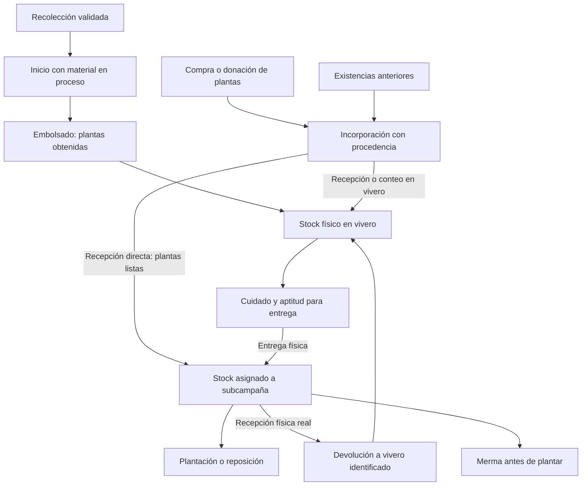

# Plan de incorporación de plantas y trazabilidad de procedencia

Fecha: 9 de septiembre de 2026. Estado: propuesta para revisión; no implementada.

Este documento parte de la conversación y de la lectura del backend, sus migraciones, el frontend local y los contratos de `r3foresta-docs`. No se consultó ni modificó la base de datos desplegada. Las observaciones sobre implementación describen estos repositorios, no certifican el estado de producción.

## 1. Recomendación

Crear **un mecanismo de incorporación de plantas**, administrado junto a los lotes de M2, que conserve una única cadena de lotes, asignaciones y consumos. Debe admitir dos destinos físicos: recepción en vivero y recepción directa en una subcampaña.

La centralización corresponde a la responsabilidad del registro. No obliga a que las plantas pasen físicamente por el vivero. Si un proveedor entrega en campo, el historial debe decirlo y el saldo físico del vivero nunca debe aumentar por esa recepción.

Las plantas recibidas en vivero, tanto compradas como donadas, continúan su cuidado y posteriormente se asignan. Las recibidas directamente en campo crean stock de la subcampaña mediante la misma entidad de asignación que ya consume Plantación. No se propone un segundo inventario exclusivo para compras.

Las existencias anteriores se incorporan mediante **saldo inicial a una fecha de corte**, manteniendo su procedencia conocida o desconocida. No son automáticamente una adquisición reciente ni producción del período.

## 2. Alcance confirmado y decisiones propuestas

Confirmado por el usuario:

- Existen compras y donaciones de plantas que necesitan continuar su desarrollo en vivero.
- También hay plantas existentes antes del uso del sistema que deben incorporarse para continuar su flujo.
- Una campaña o subcampaña puede necesitar abastecimiento externo por insuficiencia de plantas disponibles.
- Las plantas adquiridas pueden entregarse directamente en el lugar de plantación.
- Para semillas basta registrar y mostrar material ingresado, plantas obtenidas al embolsar y pérdidas. No se requiere un evento independiente de germinación.
- Esta etapa es de planificación; no se programa ni se modifica información operativa.

Decisiones recomendadas, todavía propuestas de producto:

- Una incorporación genera un lote nuevo con una sola especie, procedencia, recepción y condición inicial homogéneas.
- Una entrega física nueva no se suma silenciosamente a un lote existente, aunque coincidan especie y proveedor.
- Un único consumo de Plantación, desde asignaciones, para todos los orígenes.
- Saldo vivo y aptitud para entregar son conceptos diferentes.
- Ningún movimiento inventará recolección, germinación, embolsado, tránsito por vivero o fecha histórica.
- La primera versión no gestiona compras como proceso financiero: registra lo recibido y su procedencia.

## 3. Lo que ya existe y sus implicaciones

| Situación observada | Consecuencia para la planificación |
|---|---|
| El lote exige `recoleccion_id` y `vivero_id`. | El ingreso externo y el directo requieren modificar restricciones, DTOs y lecturas; no basta añadir un botón. |
| `INICIO` consume material de Recolección y todavía no crea plantas vivas. | Una planta comprada viva necesita una base de stock propia y explícita. |
| `EMBOLSADO` crea el saldo vivo y solo ocurre una vez. | No debe simularse ese evento para desbloquear plantas adquiridas. |
| Adaptabilidad es seguimiento opcional, sin secuencia ni permanencia mínima. | No existe hoy una garantía de madurez basada en las subetapas. |
| Asignar a subcampaña ya es una entrega física: descuenta vivero y crea stock en campo. | Reutilizar esta entidad conserva el consumo y evita descontar dos veces. |
| Plantación consume asignaciones y conserva el lote en cada detalle. | El desglose por procedencia puede reconstruirse sin otra familia de detalles de plantación. |
| La devolución aumenta el saldo del mismo lote; cancelar subcampaña también la ejecuta. | El ingreso directo obliga a identificar recepción real y evitar devoluciones ficticias. |
| La merma del stock en campo antes de plantar está prevista en cantidades, pero fuera del flujo operativo del MVP. | Hace falta cubrirla si se quiere conciliar completamente el material recibido en campo. |
| Hay historial por módulo y evidencias, pero la presentación presume origen por Recolección. | La trazabilidad externa debe llegar también a consultas, filtros, pantallas e informes. |

Referencias de implementación:

- [Tabla de lotes](/Users/pabloandresfernandezcari/Projects/R3foresta/Backend-r3foresta/migrations/007_vivero_base_tables.sql:8).
- [Validación de embolsado para asignación](/Users/pabloandresfernandezcari/Projects/R3foresta/Backend-r3foresta/migrations/052_vivero_asignar_stock_subcampania_rpc.sql:225).
- [Consumo de asignaciones en plantación](/Users/pabloandresfernandezcari/Projects/R3foresta/Backend-r3foresta/migrations/053_m3_registrar_plantacion_sin_despacho.sql:1).
- [Devolución física y cancelación](/Users/pabloandresfernandezcari/Projects/R3foresta/Backend-r3foresta/migrations/054_m3_devolucion_fisica.sql:42).
- [Alcance actual de merma en campo](/Users/pabloandresfernandezcari/Projects/R3foresta/Backend-r3foresta/migrations/055_vivero_merma_fisica.sql:12).

## 4. Alternativas y coste relativo

Las complejidades son comparativas; no son estimaciones de días ni compromisos de entrega.

| Alternativa | Ventajas | Riesgos o límites | Complejidad | Decisión |
|---|---|---|---|---|
| Registrar todo como Recolección y seguir el flujo | Pocos cambios visibles inicialmente | Exige hechos inexistentes, altera métricas y evidencia de origen | Baja aparente; coste de corrección alto | Descartar |
| Exigir recepción física en vivero para todo | Reutiliza casi todo el flujo actual | No cubre la entrega directa confirmada por el usuario | Media | Útil como primera etapa, insuficiente como solución completa |
| Registrar entrada y salida ficticias del vivero | Reutiliza saldos y asignaciones actuales | El historial de custodia y movimientos físicos sería incorrecto | Media aparente | Descartar |
| Crear inventario externo independiente en M3 | Recepción directa fácil de explicar | Duplica fuentes de stock, validaciones, devoluciones y trazabilidad | Alta | No recomendable |
| Incorporación común con destino vivero o subcampaña | Representa los hechos y conserva consumo único | Requiere adaptar origen, recepción directa, devolución y consultas | Media para vivero; media-alta con directo completo | Recomendada |
| Motor genérico de inventarios, almacenes, transferencias y mezclas | Mayor flexibilidad futura | Amplía mucho el problema actual | Muy alta | Fuera de alcance |

La opción recomendada mantiene dos formas de recepción porque existen dos realidades físicas, pero comparte identidad, procedencia, unidades, evidencias y consumo posterior.

## 5. Flujos propuestos



### 5.1 Plantas compradas o donadas que necesitan cuidado

Registrar recepción con especie, cantidad viva contada, procedencia, fecha, vivero y condición «En cuidado». El ingreso crea saldo vivo, aun si las plantas llegaron en bandejas o todavía necesitan manejo. Desde ese momento pueden registrarse pérdidas reales y seguimiento.

La aptitud para entrega se confirma después mediante un hecho registrado con fecha y responsable. El tiempo transcurrido no habilita automáticamente las plantas. Tampoco se deduce de estar embolsadas o bajo sol directo.

Un embolsado físico posterior de plantas que ya ingresaron vivas no vuelve a crear saldo. En la primera versión puede documentarse como seguimiento del manejo; no se reutiliza la operación actual de alta por embolsado para duplicar esas unidades.

### 5.2 Plantas listas recibidas físicamente en vivero

Mismo ingreso, con aptitud confirmada al recibirlas. Se pueden asignar el mismo día. No se exige una espera ni registrar adaptabilidad por obligación.

La recepción y la entrega son dos hechos reales. Se pueden presentar en una experiencia breve; cada uno conserva su significado, evidencia y efecto sobre cantidades.

### 5.3 Plantas listas entregadas directamente en campo

Una operación atómica registra procedencia, lote trazable, recepción en la subcampaña y asignación disponible. La cantidad recibida aumenta exclusivamente el stock de esa asignación. El saldo del vivero permanece en cero.

Condiciones mínimas: subcampaña válida, propósito permitido, especie compatible con el plan cuando corresponda, plantas listas, cantidad entera positiva, fecha, receptor y evidencia de entrega.

No se crea un evento «Despacho desde vivero». La asignación identifica su fuente como recepción directa. El consumo de Plantación continúa utilizando asignación, lote, especie y cantidad, igual que actualmente.

La compra solicitada o prometida todavía no es stock. Una entrega parcial registra solo las plantas efectivamente recibidas. Una misma compra recibida en varias entregas puede compartir referencia documental, conservando lotes distintos.

### 5.4 Plantas existentes antes del sistema

Hacer un conteo a una fecha de corte y crear saldo inicial por especie, procedencia conocida, ubicación y condición. Registrar únicamente el remanente que existe en ese corte, no la cantidad original comprada ni pérdidas anteriores supuestas.

Ejemplo: una compra antigua fue de 300 plantas, pero hoy existen 210. El ingreso operativo es de 210 como saldo inicial de origen compra. Las 300 pueden quedar como antecedente documental; las 90 restantes no se registran automáticamente como merma porque se desconoce su destino.

Separar fecha del conteo, fecha de registro y fecha histórica de adquisición cuando se conozca. Si esta última es aproximada o desconocida, mostrarlo. Antes de la carga se debe conciliar qué plantas ya están representadas en el sistema para evitar duplicados.

El camino de saldo inicial en campo puede reutilizar la recepción directa para plantas aún no plantadas. Importar plantaciones históricas ya realizadas es otro alcance: no se las debe volver a registrar como stock disponible.

## 6. Procedencia y datos mínimos

**La procedencia y la forma de incorporación son dos dimensiones distintas.** Un saldo inicial puede ser propio, comprado, donado o desconocido. Una devolución conserva la procedencia original: no convierte material comprado en producción propia.

Propuesta de dimensiones, con nombres técnicos por cerrar al definir el contrato:

| Dato | Regla propuesta |
|---|---|
| Modalidad de registro | Desde Recolección, recepción de plantas o saldo inicial |
| Procedencia | Producción propia, compra, donación o desconocida; desconocida requiere explicación, especialmente en legado |
| Especie | Identificador del catálogo y nombres conservados al ingresar |
| Material recibido | Plantas vivas para esta nueva incorporación; no etiquetarlas como semillas o esquejes |
| Cantidad | Entero positivo de plantas efectivamente recibidas o contadas |
| Destino de recepción | Vivero identificado o subcampaña identificada |
| Condición inicial | En cuidado o lista para entrega, determinada por responsable; si no evaluada, no se entrega |
| Fecha operativa | Recepción real o corte del inventario inicial |
| Responsable | Usuario que registra y persona/entidad receptora cuando difiera |
| Tercero de origen | Proveedor o donante cuando se conoce; texto conservado, sin catálogo obligatorio nuevo |
| Procedencia geográfica | Información disponible; no confundir dirección del proveedor con origen biológico de la planta |
| Sustento | Foto de recepción/conteo y referencia documental disponible; motivo si no existe comprobante |
| Observaciones | Motivo del ingreso, condición observada y limitaciones de información |

Una recepción externa reciente necesita identificar al tercero o declarar expresamente por qué no se conoce; no completar datos ficticios para satisfacer campos obligatorios. En saldo inicial puede no existir un comprobante histórico: un registro de conteo actual sustenta la existencia, pero no demuestra una procedencia que no se conoce.

La factura o acta de donación es útil como referencia de procedencia. El precio no es necesario para conservar stock ni distinguir compra y donación. Costes, moneda, órdenes de compra, pagos y catálogo de proveedores pueden agregarse si aparece una necesidad de gestión económica específica.

## 7. Modelo mínimo y cambios de contrato

No se propone una plataforma nueva de inventarios. La unidad trazable seguirá siendo el lote; el origen se conserva en sus datos y en el evento de incorporación, con vínculos a sus evidencias.

1. **Origen alternativo del lote.** `recoleccion_id` pasa a ser obligatorio solo para el camino desde Recolección. Las incorporaciones de plantas y los saldos iniciales no consumen saldo M1. La base de datos debe rechazar combinaciones incoherentes, no delegarlo únicamente al formulario.
2. **Identidad independiente.** Generar un código único que no dependa de una recolección inexistente. Conservar los códigos antiguos y sus enlaces. No usar el formato del código como sustituto de campos de procedencia.
3. **Base inicial de plantas.** Reconocer dos hechos válidos: plantas obtenidas en embolsado o plantas vivas incorporadas. Para el segundo, el evento indica si fue recepción reciente o saldo inicial. La base cuantitativa no significa producción propia.
4. **Cantidades de material y de plantas.** Los campos actuales que presuponen material en proceso o tipo SEMILLA/ESQUEJE deben admitir el nuevo camino explícitamente. No rellenarlos con cero, cantidades inventadas ni una semilla por planta para evitar nulos.
5. **Vivero físico opcional en directo.** `vivero_id` puede ser nulo mientras el lote nunca haya tenido custodia física en vivero. No crear un vivero virtual. Si ocurre una devolución real, registrar el vivero receptor y conservar el destino inicial en el historial.
6. **Asignación con fuente identificada.** Conservar la tabla y el consumo actuales; distinguir entrega desde vivero y recepción directa. Ampliar las restricciones de eventos que hoy solo permiten referencias M2–M3 en despacho y devolución.
7. **Aptitud para entrega.** Añadir una condición sencilla y su historial de confirmación/cambio. Tener plantas vivas habilita seguimiento y merma; estar listas habilita asignación o salida para plantación. No crear calendarios automáticos de maduración.
8. **Estado de lotes directos.** No ejecutar al ingreso el cierre actual que podría interpretar saldo cero sin despachos como pérdida total. Propuesta: representar ausencia de saldo M2 con motivo específico de entrega directa, reutilizando el estado finalizado del inventario M2 si resulta compatible. La asignación sigue activa y la trazabilidad continúa. Una recepción posterior real reabre el inventario M2.

La aptitud es una ampliación de producto: hoy el embolsado basta para entregar. Se recomienda aplicar la misma condición a los nuevos lotes propios e incorporados. Para lotes existentes, no reescribir salidas pasadas ni marcar automáticamente «listo» por edad; confirmar la condición antes de su próxima salida. Esta transición debe planificarse para que el equipo sepa qué revisar.

Para evitar dividir lotes por fracciones de madurez, la primera versión considera homogénea su condición. Si una entrega llega con plantas en condiciones distintas, se crean lotes separados desde la recepción. Maduración parcial posterior y división/fusión requieren una decisión adicional, porque el contrato vigente las excluye.

## 8. Devoluciones, pérdidas y cierre

### Recepción real de devoluciones

La primera devolución de un lote que ingresó directamente en campo exige seleccionar un vivero real. La operación disminuye el saldo de la asignación y aumenta ese mismo lote en el vivero receptor, manteniendo su origen externo y su recepción inicial en campo.

Para mantener el alcance acotado, un lote tendrá un único vivero físico receptor. Retornos posteriores vuelven a ese mismo vivero. Repartir retornos del mismo lote entre varios viveros requiere división o transferencias y queda fuera de esta primera versión.

La recepción también debe registrar su condición: plantas devueltas dañadas o que requieren cuidado no se habilitan automáticamente para una nueva plantación.

### Merma antes de plantar

Registrar un evento de pérdida sobre la asignación con cantidad, causa, fecha, responsable y evidencia. Aumenta `cantidad_mermada`, con límite por saldo disponible. No disminuye stock del vivero y no se registra como mortalidad de árboles ya plantados.

Este es un complemento acotado pero necesario para conciliar entregas directas reales. Sin él, una planta que muere en campo antes de plantar quedaría como disponible o tendría que declararse falsamente devuelta.

### Cancelación y desactivación

No permitir que cancelar una subcampaña o desactivar una campaña convierta saldos de recepción directa en devoluciones automáticas a un vivero inexistente.

Regla mínima recomendada: antes de terminar esas operaciones, resolver los remanentes de recepción directa mediante recepción real en vivero o merma real. Si siguen en campo, la operación informa la cantidad y el destino pendientes y no inventa su traslado. Los controles se realizan de forma atómica frente a consumos o recepciones concurrentes.

El cierre de la fase de plantación inicial debe bloquearse mientras exista saldo pendiente de propósito `PLANTACION_INICIAL`; primero se resuelve con hechos reales. La comprobación y el cierre deben ser atómicos. Se distingue ese remanente del stock de reposición: el sistema permite mantenimiento y reposiciones después de completar la plantación inicial. No se debe bloquear mantenimiento legítimo por tratar todos los propósitos como uno solo.

El flujo legado de devolución automática también merece comprobarse contra la operación real. Su existencia no justifica extender esa presunción a los nuevos ingresos directos.

## 9. Historial y presentación

La entrega debe incluir el historial utilizable desde el primer alcance, porque el usuario lo considera prioritario. No alcanza con guardar la procedencia en una columna oculta.

### Vista de un lote

Mostrar una cabecera con especie, origen, modalidad de incorporación, proveedor/donante si corresponde, fecha real o corte, condición y lugar de recepción. Luego una secuencia de hechos con cantidad/unidad, responsable, evidencia y efecto sobre saldo.

Para una compra directa: «Recepción directa en subcampaña → plantaciones parciales → merma previa a plantación/devolución real», según lo ocurrido. No insertar etapas omitidas como si hubieran sucedido.

Para saldo inicial: «Existencias verificadas al corte; historial previo no registrado». La antigüedad desde el ingreso al sistema no se presenta como edad biológica ni como duración total de crianza.

### Vista de stock

Separar cantidades que responden a preguntas distintas:

- Material de Recolección disponible, por especie, tipo y unidad.
- Material en proceso en vivero, aún sin conteo de plantas obtenido.
- Plantas físicas en vivero: en cuidado y listas para entregar.
- Plantas entregadas a subcampañas y todavía sin plantar.
- Plantas ya plantadas, diferenciando plantación inicial y reposición.

El total de una especie puede agrupar procedencias para operación, con desglose por origen y lote accesible. En el registro de plantación se puede conservar el consumo automático por fecha/asignación existente, mostrando en el resumen qué lotes y procedencias se consumen. No añadir selección manual de proveedor sin necesidad operativa.

### Vista de auditoría y campaña

Desde un detalle de plantación debe poder recorrerse: registro → asignación → lote → incorporación o Recolección → evidencia disponible.

El informe por campaña/subcampaña debe poder responder cuántas plantas se recibieron, plantaron, perdieron antes de plantar o devolvieron, y cuántas siguen pendientes en sus asignaciones, desglosadas entre producción propia, compra, donación y procedencia desconocida. El saldo físico que queda en un lote de vivero se presenta por lote/origen como stock compartido: no se atribuye íntegramente a cada campaña que recibe plantas de ese lote. Las otras salidas del vivero también se consultan en ese nivel. Las incorporaciones de saldo inicial se desglosan además por modalidad para no inflar actividad del período.

Una donación recibida y una donación entregada son movimientos de sentido opuesto. Se distinguen por tipo de evento y efecto de saldo.

No mostrar «supervivencia» calculada como saldo del vivero dividido entre plantas iniciales: una entrega reduce ese saldo aunque todas las plantas sigan vivas. La procedencia de lo plantado sí se obtiene por detalle; supervivencia por proveedor/origen solo será exacta si las mediciones permiten atribuir las pérdidas. La mortalidad actual por grupo puede mezclar lotes, por lo que no se repartirá proporcionalmente como si fuese observada.

### Ajustes concretos de presentación detectados

- El mapeador backend convierte actualmente identificadores a números sin conservar nulos; debe evitar `0` como origen o vivero inexistente: [mapeo de lote](/Users/pabloandresfernandezcari/Projects/R3foresta/Backend-r3foresta/src/lotes-vivero/application/vivero-consultas.service.ts:443).
- El historial backend debe exponer vínculos de asignación, subcampaña y fuente, además de los datos del nuevo ingreso: [timeline](/Users/pabloandresfernandezcari/Projects/R3foresta/Backend-r3foresta/src/lotes-vivero/application/vivero-timeline.service.ts:135).
- El frontend contiene una lista cerrada de eventos aceptados que incluso omite devolución; si no se actualiza, puede ocultar eventos nuevos: [mapeador frontend](/Users/pabloandresfernandezcari/Projects/R3foresta/pwa-r3foresta/src/modules/vivero/mappers/lote.mapper.ts:6).
- Las tarjetas enlazan a Recolección y usan el saldo físico en una barra llamada supervivencia: [tarjeta de origen](/Users/pabloandresfernandezcari/Projects/R3foresta/pwa-r3foresta/src/modules/vivero/components/OrigenCard.tsx:26), [tarjeta de lote](/Users/pabloandresfernandezcari/Projects/R3foresta/pwa-r3foresta/src/modules/vivero/components/ViveroLotCard.tsx:119).
- El resumen disponible por especie parte de lotes activos con saldo M2 positivo; sirve para disponibilidad física, pero no debe reutilizarse como inventario global de todas las asignaciones, en especial las directas: [consulta de saldos](/Users/pabloandresfernandezcari/Projects/R3foresta/Backend-r3foresta/src/lotes-vivero/application/vivero-saldos.service.ts:142).

## 10. Semillas, cantidades e indicadores

Conservar la decisión actual de no crear evento de germinación, confirmada en esta conversación y documentada en [ADR-VIV-08](/Users/pabloandresfernandezcari/Projects/R3foresta/r3foresta-docs/decisiones/00_decisiones_vivero.md:162).

Mostrar por origen M1: material registrado, disponible, enviado a vivero y desechado. Mostrar por lote M2: material recibido, plantas obtenidas al embolsar, descarte pre-embolsado si lo hubo, mermas de plantas y destinos posteriores.

Reglas de interpretación:

- «Plantas obtenidas al embolsar» no equivale a un conteo exacto de semillas germinadas.
- Si ingresaron 500 g de semillas y se embolsaron 320 plantas, ambas cantidades se muestran con su unidad. No se restan ni se calcula un porcentaje de germinación.
- Si se contaron semillas por unidad, un rendimiento de obtención requeriría una cohorte comparable; tampoco se rotula automáticamente como germinación.
- El descarte pre-embolsado actual es total. No afirmar que existe una medición detallada de todas las pérdidas parciales durante germinación.
- La transformación del material no es un consumo adicional de plantas ya incorporadas vivas.
- Compras, donaciones y saldo inicial no aumentan «plantas producidas en el período».
- Un origen desconocido sigue siendo una categoría visible; no se reparte entre propio y externo por suposición.

El resumen actual de stock de Recolección filtra SEMILLA; no mezcla esquejes en ese endpoint. Si se amplía a otros materiales, deben mantenerse separados por tipo y unidad: [consulta actual](/Users/pabloandresfernandezcari/Projects/R3foresta/Backend-r3foresta/src/recolecciones/application/recoleccion-consultas.service.ts:278).

Identidades operativas para plantas, por lote y sin mezclar unidades:

```text
Saldo físico en vivero
= plantas obtenidas o recibidas allí + saldo inicial allí
  + devoluciones físicas recibidas
  - entregas a subcampañas - otras salidas - mermas en vivero

Saldo de una asignación
= cantidad entregada desde vivero o recibida directamente
  - cantidad plantada - cantidad devuelta - merma antes de plantar
```

El ingreso directo no aparece como entrada al saldo físico de vivero. Su evento de incorporación y su evento enlazado en M3 describen una sola recepción y no se suman como dos entradas. Al consolidar, entregas y devoluciones internas se compensan; no son adquisiciones ni producción adicionales.

Para abastecimiento, mostrar por especie: meta pendiente, stock disponible ya recibido por la subcampaña y stock apto en vivero. Una cantidad sugerida para conseguir puede calcularse desde el faltante, pero el stock general de vivero no es una reserva garantizada para varias subcampañas. El sistema no comprará automáticamente ni cambiará metas por recibir plantas extra.

## 11. Integridad sin añadir un sistema complejo de auditoría

- Incorporación y su efecto en stock/eventos se confirman en una transacción. La recepción directa incluye la asignación; un fallo no deja lote o saldo parcial.
- Una clave de operación evita duplicar ingresos por doble clic, reintento de red o reenvío de la PWA. Una referencia de factura por sí sola no basta: puede tener varias entregas legítimas.
- Las evidencias se vinculan al hecho real. Una foto de recepción directa no se etiqueta como despacho del vivero.
- Los controles de permisos deben cubrir el destino: registrar recepción de vivero no concede automáticamente derecho a abastecer cualquier subcampaña. La identidad auditada se obtiene de la sesión verificada, no de un responsable arbitrario enviado por el cliente.
- Los eventos confirmados no se borran ni se sobrescriben. Debe existir una salida acotada para errores: reversión identificada del ingreso y, en directo, de su asignación inicial, si no existen consumos ni movimientos posteriores. Si los hay, rechazar reversión simple y exigir corrección que conserve esas dependencias. No hace falta diseñar ahora un motor general de ajustes.
- La procedencia conocida se conserva como snapshot; rectificaciones posteriores, si se admiten, deben dejar anterior, nueva, responsable y motivo. No modificar silenciosamente la atribución histórica de lo plantado.
- Para saldo inicial usar una fecha de corte reciente, conservando antecedentes aparte. La ventana operativa vigente es de diez días; no abrirla globalmente para inventar operaciones antiguas: [regla de fecha](/Users/pabloandresfernandezcari/Projects/R3foresta/Backend-r3foresta/migrations/010_vivero_operational_rules.sql:326).
- La migración 015 lleva fechas de auditoría M1/M2 a granularidad de día. No prometer horas históricas que no se almacenan. Si se exige hora exacta para nuevos ingresos, definir un sello de registro nuevo sin fabricar precisión pasada: [granularidad actual](/Users/pabloandresfernandezcari/Projects/R3foresta/Backend-r3foresta/migrations/015_temporal_granularity_day_only.sql:84).
- PostgreSQL y sus eventos bastan para esta ampliación. El anclaje blockchain existente de Recolección no certifica automáticamente un ingreso externo; no se necesita ampliar esa integración para cerrar el stock y la procedencia.

## 12. Riesgos prioritarios y medidas

| Riesgo | Medida mínima |
|---|---|
| Doble conteo de una recepción o de existencias ya registradas | Idempotencia y conciliación del inventario al corte |
| Plantas inmaduras disponibles para plantación | Separar saldo vivo de aptitud de entrega |
| Embolsado ficticio o duplicado para plantas adquiridas | Evento real de incorporación y base de stock alternativa |
| Compra antigua contada como ingreso/producción reciente | Separar saldo inicial, procedencia y fechas |
| Plantas directas aparecen físicamente en vivero | Recepción directa sobre asignación; saldo M2 cero |
| Cancelación genera retorno que no ocurrió | Resolver recepción real/merma y comprobar remanentes antes de finalizar |
| Pérdidas en campo quedan disponibles | Evento de merma sobre asignación |
| Nuevos eventos almacenados pero invisibles | Actualizar contratos, filtros, mapeadores, historial y exportación juntos |
| Proveedor y origen biológico se confunden | Campos/etiquetas diferentes, desconocido explícito |
| Informe atribuye salida a muerte o compra a producción | Métricas por hecho, lugar, modalidad y procedencia |
| Reglas antiguas rechazan lotes nuevos | Revisar todas las dependencias de EMBOLSADO, Recolección, vivero no nulo y cierre automático |
| Aumenta demasiado el alcance | Posponer finanzas, mezclas, multivivero, germinación detallada y certificación externa |

## 13. Secuencia de implementación futura

Estas etapas son una hoja de ruta. Ninguna se ejecutó durante esta planificación.

| Etapa | Entregable | Complejidad relativa | Condición de salida |
|---|---|---|---|
| 1. Contrato de dominio | Reglas de origen, ingreso, aptitud, destinos, fechas, devolución y métricas; actualización de M2 y frontera M2–M3 | Baja-media | Casos y términos acordados; revisión del esquema desplegado |
| 2. Incorporación en vivero e inventario inicial | Datos/constraints, operación atómica, evidencia, saldo vivo, aptitud, continuidad de merma y asignación | Media | Compra inmadura, donación lista y saldo inicial continúan su flujo sin eventos ficticios |
| 3. Recepción directa y remanentes | Fuente directa de asignación, vivero opcional, devolución real, merma en campo y protección de cancelación/desactivación | Media-alta | Directo completo hasta plantación, pérdida o recepción de remanente |
| 4. Presentación y auditoría integradas | Formularios, stock, historia, filtros y desglose de procedencia en M2/M3 e informes | Media | Usuario puede reconstruir cantidades y origen sin consultar tablas |
| 5. Transición y verificación | Carga inicial conciliada, compatibilidad legada, verificaciones de concurrencia y recorrido completo | Media | No duplicados, saldos conciliados y trazabilidad verificable |

La presentación se desarrolla con cada flujo; la etapa 4 consolida el recorrido y no pospone el historial hasta después de la entrega. La etapa 2 puede verificarse por separado, pero el alcance solicitado no estará completo mientras falte la recepción directa confirmada.

La mayor complejidad está en modificar las suposiciones actuales y resolver devoluciones, no en el formulario. Por eso esta ampliación completa se considera **media-alta**, aunque conserve la arquitectura principal.

Primero deben revisarse las reglas y contratos canónicos de `r3foresta-docs`, que todavía definen Recolección como origen obligatorio y embolsado como nacimiento único del saldo. Las menciones al ingreso externo en el alcance académico no sustituyen ese diseño operativo. Después se alinea base de datos, API y frontend.

## 14. Casos de aceptación

| Caso | Resultado que debe comprobarse |
|---|---|
| Compra de 100 plantas en cuidado | 100 vivas en vivero; 0 listas para asignar; origen compra visible |
| Merma de 10 antes de habilitar esa compra | 90 vivas; pérdida identificada; sin consumo M1 ni embolsado inventado |
| Confirmar aptitud de las 90 | Pueden entregarse; fecha y responsable quedan en historial |
| Donación de 80 listas y asignación de 60 el mismo día | 20 en vivero y 60 en campo; donación recibida distinta de salida |
| Compra directa de 100, plantación de 70, pérdida previa de 5 y devolución de 25 | 70 plantadas externas, 5 perdidas en campo, 25 recibidas en vivero real, 0 pendientes en asignación; nunca hubo entrada inicial de 100 al vivero |
| Recepción directa sin vivero, todavía no plantada | Visible en stock de subcampaña y auditoría; no desaparece por filtros de lotes con saldo M2 positivo |
| Cancelar subcampaña con remanente directo de 20 | No genera retorno ficticio; informa las 20 pendientes de resolver |
| Cerrar plantación inicial con 10 plantas de ese propósito pendientes | Bloquea el cierre hasta resolverlas y evita carreras con recepciones o consumos concurrentes |
| Cierre inicial con reposición permitida | Se distinguen propósitos y no se bloquea mantenimiento legítimo |
| Compra antigua de 300 con remanente contado de 210 | Saldo inicial 210; no declara compra actual ni merma histórica de 90 |
| Existencias previas de origen desconocido | Continúan el flujo; origen desconocido e inicio de historia al corte visibles |
| Misma especie de producción propia, compra y donación | Se puede plantar desde varias asignaciones y recuperar las cantidades exactas por origen |
| 500 g de semillas y 320 plantas embolsadas | Presenta ambas unidades; no calcula 64 % de germinación ni 180 plantas perdidas |
| Reintentar la misma incorporación | Se confirma una única entrada, lote y efecto de saldo |
| Dos usuarios intentan consumir el mismo saldo | Solo se admite el total realmente disponible; nunca negativo |
| Cambio en catálogo o tercero después del ingreso | El historial mantiene los datos que sustentaron el hecho, o muestra una rectificación trazable |
| Asignación total de plantas vivas | El saldo del vivero puede quedar en cero sin mostrarse como 100 % de mortalidad |
| Regreso a vivero de plantas de origen compra | Conservan ese origen y requieren condición de recepción antes de nueva entrega |
| Lotes y registros anteriores | Mantienen códigos, vínculos y cantidades; no reciben historia inventada durante la migración |

## 15. Límites que mantienen sencilla la primera versión

Quedan fuera: contabilidad y pagos, órdenes de compra, proveedores como módulo obligatorio, automatización de adquisiciones, reserva lógica paralela, creación de una recolección por cada compra, seguimiento individual de cada planta, evento de germinación, conversiones automáticas de gramos a plantas, mezcla/división de lotes, varios viveros físicos simultáneos para el mismo lote, importación masiva de plantaciones históricas y supervivencia exacta por origen sin medición atribuible.

También se evita una API pública universal de «ajustar stock». Cada aumento o disminución debe tener un motivo operativo concreto. Esta restricción mantiene el historial explicable sin construir un sistema general de contabilidad de inventarios.

Las decisiones de negocio que quedan para revisar son acotadas: quién confirma aptitud, qué evidencia mínima se acepta cuando faltan comprobantes antiguos y cómo coordinar el conteo inicial. Para este plan se asume confirmación por responsable operativo autorizado, evidencia actual de recepción/conteo y explicación de antecedentes faltantes. Ninguna de esas decisiones requiere duplicar el flujo de Plantación.
